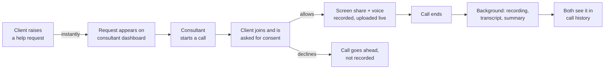

# Client Help Portal: product one-pager

**Live:** https://client-help-portal.onrender.com · **Code:** [README](../README.md) · **AI process:** [AI_WORKFLOW.md](AI_WORKFLOW.md)

## Problem

A consultant supports several clients. When a client gets stuck in some software, typing it out in tickets is slow and lossy. It's faster for the consultant to see the client's screen and talk them through it. Afterwards, both sides need a record of what was wrong, what was done, and who does what next, without anyone writing notes.

**Users:** one **consultant** (helps, starts calls) and their **clients** (raise requests, share their screen).

## Core flow

## Product decisions I made where the brief was open

| Question | Decision | Why |
|---|---|---|
| How many consultants? | One, and each client is assigned to them | Matches the brief; the data model already stores the assignment, so routing across several consultants is additive |
| Client declines recording? | The call still happens, unrecorded | Getting help matters more than the record; consent has to be a real choice |
| Where is consent enforced? | On the server: recording chunks are rejected until the client agrees | UI-only consent can be bypassed |
| Who sees the history? | Both participants, nobody else | The brief says "both sides get" it; every query is ownership-scoped (404 for anyone else) |
| Retention | Kept, with no deletion in v1 | Not in scope; a retention policy is on the roadmap |
| Devices | Desktop browsers (Chrome/Edge) | Browsers on phones can't share the screen; the scenario is a client stuck in software on their computer |
| Reviewer experience | A live link, one-click demo logins, mock AI when there are no keys | The demo should work in one minute with zero setup |

## Scope

**In (v1):** seeded logins for two roles · realtime requests · 1:1 screen-share calls with voice · consent-gated recording uploaded during the call · background transcript (with speaker labels) and summary · click a transcript line to seek · rejoin after a refresh · an ops page for pipeline health and cost · access control with tests.

**Out (for now):** routing across several consultants · scheduling · group calls · mobile screen share · editing summaries · deleting recordings.

## How we know it's working

| Metric | Status |
|---|---|
| Time from call end to summary (p50/p95), per-step latency, failures, retries | **Tracked**, on the Ops page |
| Estimated cost per call (speech-to-text minutes + LLM tokens) | **Tracked**, on the Ops page |
| Summary faithfulness and resistance to prompt injection | **Tracked**, by the eval (`npm run eval`; baseline 8/8, 5.0/5) |
| Time from request to call start (how fast clients get help) | Proposed next |
| Call connect rate, recording consent rate | Proposed next |

## Risks and mitigations

| Risk | Mitigation |
|---|---|
| Strict networks block direct calls | Cloudflare TURN relay with short-lived credentials; verified live with direct paths blocked |
| The AI summary invents things | Schema-constrained output, a grounding prompt, no model call for empty calls, and an eval set that catches regressions |
| Privacy | Server-enforced consent; one ownership rule on every query; recordings served only through short-lived signed links |
| A tab crashes mid-call | Recording uploads in 4 s chunks, and rejoining continues it as a new segment |
| Free-tier AI limits | Fallback across several models, retries with backoff, per-model timeouts |

## How it's built

| Part | Technology |
|---|---|
| Web app | Vue 3, Vite, Pinia, Vue Router, Tailwind CSS |
| API | NestJS 11 (TypeScript), class-validator, JWT auth with role guards |
| Realtime | Socket.IO (JWT-authenticated handshake, per-user and per-call rooms) |
| Calls | WebRTC peer-to-peer; Cloudflare TURN relay as fallback |
| Recording | MediaRecorder (WebM) and Web Audio mixing in the consultant's browser; ffmpeg finalisation on the server |
| Database | PostgreSQL (Neon) with Prisma |
| Background jobs | A queue on Postgres (`FOR UPDATE SKIP LOCKED`), one retryable job per step |
| File storage | Cloudflare R2 (S3 API); local disk in development |
| Speech-to-text | Deepgram nova-3 (word timings, diarization) |
| Summary | Gemini (free tier) or Claude, behind one interface; output validated with Zod |
| Hosting and CI | Render, GitHub Actions (CI + keep-warm) |
| Tests | Jest + Supertest (access control), Playwright (two-browser E2E, real-speech and relay-only runs), summary eval |

## What's next

1. **Server-side recording** (media-server egress), so the recording doesn't depend on one browser tab.
2. **Routing across several consultants:** a shared queue, availability, and handover.
3. **Notifications** when a request is raised and nobody is online (email or push).
4. **A retention policy**, plus letting clients delete a recording.
5. **The eval in CI** on every prompt or model change, with a cross-vendor judge.
